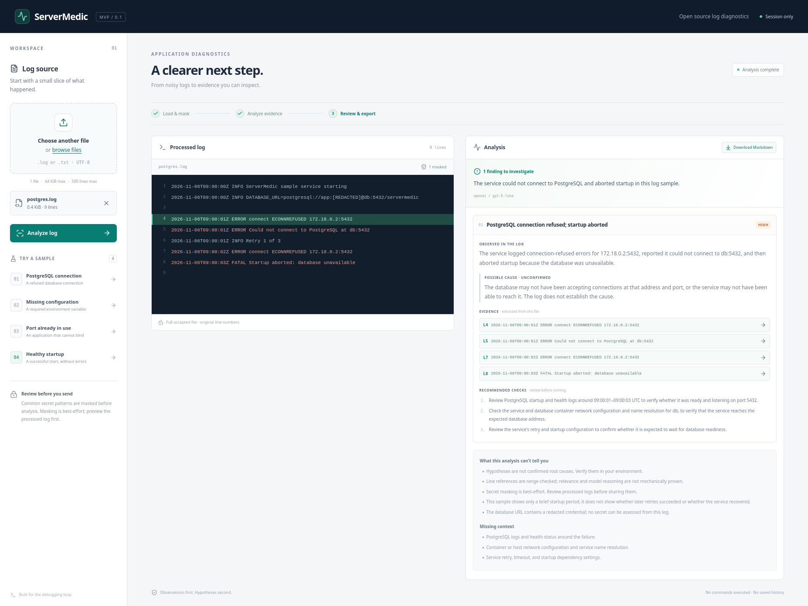
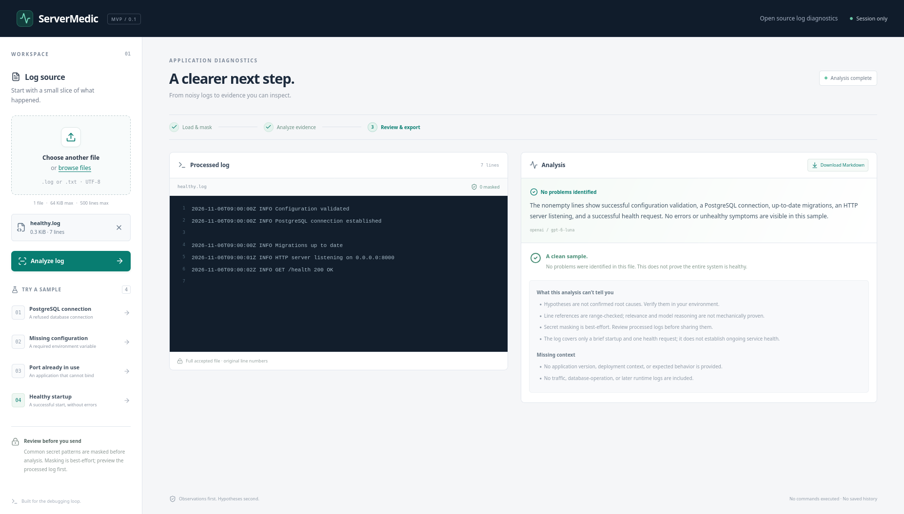

# ServerMedic

**Evidence you can inspect. A clearer next step.**

ServerMedic is an open source log-analysis workspace for small application logs. Upload a file, review its masked contents, and get observations, possible causes, original line references, and recommended checks. Export the verified result as Markdown.

The app suggests diagnostic steps. It does not connect to servers, run commands, repair infrastructure, or prove root causes.

## Screenshots

### Evidence-backed analysis



### Healthy startup



## Quick start with Docker Compose

Requirements: Docker Engine/Desktop with Docker Compose v2 or later. You need an OpenAI API key and an API model with Responses API + Structured Outputs support for AI analysis. Preview works without either.

From the repository root:

```bash
test -f .env || cp .env.example .env
# Edit .env locally: set OPENAI_API_KEY and LLM_MODEL.
docker compose up --build --wait
```

On Windows PowerShell, use `if (-not (Test-Path .env)) { Copy-Item .env.example .env }` for the first command.

Open [http://localhost:8080](http://localhost:8080). Load the PostgreSQL sample, inspect the masked password on line 2, then click **Analyze log**. Select an evidence line to jump to it in the viewer. Click **Download Markdown** to export the report.

Stop with `docker compose down`. The default port binds to localhost. Logs and reports are not persisted by the application.

**Verification:** Initial automated checks (66 backend tests and 8 browser scenarios with an explicit test provider) are recorded in [docs/verification.md](docs/verification.md). Subsequent user-run Docker Compose startup and manual acceptance of all four synthetic samples using `openai / gpt-6-luna` are recorded in [the local MVP acceptance report](docs/ServerMedic_MVP_Acceptance_2026-11-06.md). Inspect the repository Actions tab for actual GitHub CI results after publication.

## What the MVP includes

- Exactly one `.log`/`.txt` UTF-8 file per request, up to **64 KiB (65,536 original bytes)** and **500 lines**, including blank lines.
- A server-processed preview with original 1-based line numbers and common secret patterns masked.
- Full-file analysis, with no selection, sampling or truncation of accepted input.
- A compact Pydantic schema with separate observations and unconfirmed hypotheses.
- Server-checked line numbers and evidence extracted directly from the processed file.
- Initial, preparing, selected, analyzing, complete and error states; four synthetic examples.
- Zero findings for healthy/insufficient input when appropriate, plus limitations and missing context.
- A server-generated Markdown report built only after schema and citation checks pass.
- Backend tests, SDK transport tests, TypeScript/build checks, browser tests and GitHub Actions.

## Architecture

| Component | Responsibility |
| --- | --- |
| React + TypeScript + Vite | Select file, request masked preview, inspect results, focus evidence lines, download Markdown |
| FastAPI + Pydantic | Validate bytes/UTF-8/lines, mask secrets, call analyzer, verify result, extract quotations, build report |
| OpenAI Python SDK | `AsyncOpenAI.responses.parse(..., text_format=Analysis)` using Responses API, no tools, no retries, `store=False` |
| Nginx | Serve production frontend and proxy same-origin `/api` requests |
| Docker Compose | Run the two services; no database, queue or storage volume |

Selection sends the file to `/api/preview` without calling a model. Analysis sends that same browser-held `File` to `/api/analyze`, which repeats validation and redaction and completes in a single request. The browser renders only the server's processed text. The backend holds no preview sessions or report history.

The analyzer implements a small `Analyzer` protocol in `backend/app/llm.py`. Tests inject an implementation through `create_app(settings, analyzer=...)`; the production entry point always uses OpenAI. There is no production environment switch silently returning mock diagnoses.

| Location | Contents |
| --- | --- |
| `backend/app/` | API, input preparation, redaction, schemas, analyzer, verification, Markdown |
| `backend/tests/` | Stub tests, SDK mocked transport tests, explicit browser fixture application |
| `frontend/src/` | React workspace and typed HTTP contract |
| `frontend/tests/` | Playwright browser scenarios |
| `examples/` | Synthetic logs and `expected.json` observation/evidence expectations |
| `docs/` | API contract, sprint plan, verification record, demonstration script |
| `.github/workflows/ci.yml` | Backend, frontend/browser and container checks |

Full request/response and line-counting rules: [docs/api.md](docs/api.md).

## Configuration

Copy `.env.example` to `.env` in the repository root. The backend reads it for local development; Compose passes its variables only to the backend. Environment variables take precedence. No API key is embedded into the frontend image or Vite build.

| Variable | Default | Meaning |
| --- | --- | --- |
| `OPENAI_API_KEY` | empty | Server-side API credential; required for analysis |
| `LLM_MODEL` | empty | Exact API model ID with Responses + Structured Outputs support; required for analysis |
| `LLM_TIMEOUT_SECONDS` | `60` | Whole call deadline, 1–180 seconds; SDK retries disabled |
| `LLM_MAX_OUTPUT_TOKENS` | `6000` | Output budget, 256–16,000; incomplete responses are rejected |
| `WEB_PORT` | `8080` | Local Compose frontend port |

Choose a model available to your API project using the [OpenAI model catalog](https://developers.openai.com/api/docs/models) and verify Structured Outputs support. Ensure its context window covers the complete accepted log and output budget. The model/reasoning mode used for developing the project, including GPT‑6.1 Sol Max, is separate from `LLM_MODEL`; this app does not assume an API ID or expose a “Max” setting.

Official documentation checked during implementation on 2026-11-06: [Structured Outputs](https://developers.openai.com/api/docs/guides/structured-outputs) and [OpenAI libraries](https://developers.openai.com/api/docs/libraries). SDK and dependencies are pinned in the committed requirements and npm lockfile.

## Local development

Requirements: Python 3.12 and Node.js 24. From the repository root:

```bash
python -m venv .venv
. .venv/bin/activate
python -m pip install -r backend/requirements-dev.txt
test -f .env || cp .env.example .env
```

On Windows use `py -3.12 -m venv .venv`, `.venv\Scripts\Activate.ps1` and `Copy-Item .env.example .env` instead.

Backend terminal, after activation, from `backend/`:

```bash
python -m uvicorn app.main:app --host 127.0.0.1 --port 8000 --no-access-log
```

Frontend terminal, from `frontend/`:

```bash
npm ci
npm run dev
```

Open [http://localhost:5173](http://localhost:5173). Vite proxies `/api` to port 8000. Backend OpenAPI docs are at [http://localhost:8000/docs](http://localhost:8000/docs).

No API key? To explore the **test-only UI pipeline**, run `python -m uvicorn tests.browser_app:app --host 127.0.0.1 --port 8000 --no-access-log` from `backend/`, instead of the production backend. The interface identifies the provider as `test`, displays a fixture banner, and only the synthetic examples have meaningful fixture results. This mode does not evaluate model quality.

## Checks without an API key

From `backend/` with the Python environment activated:

```bash
ruff check app tests smoke_real.py
pytest -q
```

From `frontend/` (activate the same Python environment so Playwright can start the test backend):

```bash
npm ci
npm run typecheck
npm run build
npx playwright install --with-deps chromium
npm run test:e2e
```

Stop manually started servers on ports 8000/4173 first. Playwright launches its own FastAPI **test fixture** application and Vite. Its scenarios cover sample and local uploads, loading/result/error states, masking, preserved blank lines, line focus, healthy output, downloaded Markdown and a narrow viewport. `BACKEND_PYTHON` can override the test Python executable. `PLAYWRIGHT_CHROMIUM_EXECUTABLE_PATH` optionally selects an existing Chromium binary; normally use Playwright's downloaded browser.

Backend tests use injected providers. SDK tests exercise the real official SDK parser and schema serialization through an **in-memory mocked HTTP transport**. They never call OpenAI. All automated jobs run without model credentials.

The CI container job builds both images, starts Compose, checks frontend/health/redaction and verifies that missing model configuration returns a useful 503. It does not validate live inference.

## Real API acceptance (separate, opt-in)

Set your key and model locally, then from `backend/`:

```bash
python smoke_real.py        # One paid request: PostgreSQL example
python smoke_real.py --all  # Up to four paid requests: all examples
```

Without configuration it prints `SKIPPED` and exits 2; no request is sent. With configuration it checks SDK/schema/evidence/report handling and coarse sample expectations, printing results for human review. A structural pass is not proof of diagnostic accuracy. Manually check whether observations match the lines and hypotheses avoid unsupported certainty. The real browser path should then be repeated with `app.main:app`.

## Examples

| File | Expected observation | Supporting lines |
| --- | --- | --- |
| `postgres.log` | PostgreSQL connection is refused; startup aborts | 4, 5, 7, 8 |
| `missing-env.log` | Required `APP_SECRET` is not set; startup aborts | 3, 4, 5 |
| `port-in-use.log` | Bind to `0.0.0.0:8000` fails because the address is in use | 4, 5, 6 |
| `healthy.log` | Successful startup and health request; expect no findings | 1, 2, 4, 5, 6 |

These are synthetic files, containing no real credentials. They pass through the exact same preview/analyze endpoints as user files. `examples/expected.json` records expected observations and missing context, not guaranteed model output. [docs/demo.md](docs/demo.md) gives a 60–90 second presentation script.

## Privacy and limitations

- Masking is **best-effort**, based on line-local patterns: URL user-info passwords, password/token/secret/API-key assignments, Authorization/Proxy-Authorization values, Bearer/Basic credentials and common `sk-...` keys. It may over-mask benign content or miss custom names, unusual delimiters, escaped/nested values, multiline secrets, PEM keys, encoded data, bare unlabeled credentials and personal information. Hosts, usernames, addresses and other context remain visible. Review the processed preview before analysis.
- Both preview and analysis send the raw file to your backend. Only masked text and filename go to OpenAI. Preview, evidence and Markdown use masked text. Generated prose is masked again for the same common patterns. `store=False` is requested; it does not promise zero provider retention. Consult your API account's data controls before using sensitive logs.
- Original and processed contents exist transiently in browser/backend memory. No localStorage, database or application log/report cache is used; refreshing/removing the file clears the UI state. API responses use `Cache-Control: no-store`. Application access logging is disabled in the supplied launch commands. Operating systems, proxies and model providers have their own behavior.
- Schema and range checks reject invalid references but cannot prove relevance, factual correctness, diagnosis quality or command safety. All causes remain hypotheses and checks require human judgment. Logs are untrusted data; a system instruction separates them from instructions, and no model tools are enabled. Prompt injection is not mechanically eliminated.
- Only UTF-8 is supported, with optional BOM. ANSI escape sequences/binary controls are rejected. CRLF/CR become LF. Blank and trailing empty lines are counted and preserved. A final newline adds a final empty line; see the exact contract.
- No accounts, history, database, queue, RAG, Kubernetes, server integrations or automatic fixes. There are no public-service rate limits, auth or multi-user capacity controls. The Compose port binds to localhost; add appropriate controls before exposing a paid API-backed service.
- Model access, billing, context limits and latency depend on your configured API project. Retries are explicit user actions. Timeouts, refusals, unavailable API and malformed output produce errors instead of invented results.

## License

Original project code is licensed under the [MIT License](LICENSE). Dependencies and their assets retain their respective licenses. Lucide icons are provided by `lucide-react` under its ISC license.
